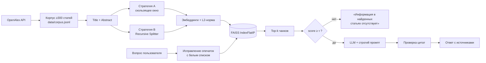

# RAG-поиск по научным статьям

Полный конвейер **Retrieval-Augmented Generation** на корпусе из 300+ реальных научных статей
по теме *Retrieval-Augmented Generation & Vector Databases*: от сбора данных через REST API до количественной
оценки поиска и генерации. Система отвечает на вопросы **только** по найденным статьям, ставит ссылки
`[Название (Год)]` и честно отказывает, если ответа в корпусе нет.

> Лабораторная работа «RAG-поиск»

## Что внутри

| Этап | Реализация | Ключевая идея |
|---|---|---|
| Сбор корпуса | OpenAlex API, cursor-пагинация, `Retry` + backoff | декодирование `abstract_inverted_index`, дедупликация по ID и заголовку, кэш `corpus.jsonl` |
| Чанкинг | **A**: скользящее окно 130/25 слов (Python) · **B**: `RecursiveCharacterTextSplitter` 700/100 | заголовок в каждом чанке, полные метаданные у каждого фрагмента |
| Векторизация | `bge-small-en-v1.5` / `all-MiniLM-L6-v2`, FAISS `IndexFlatIP` | L2-нормализация → скалярное произведение = косинус |
| Запросы | Дамерау-Левенштейн (`rapidfuzz`) + белый список | исправляет `retreival`, не трогает `LoRA`, `ColBERT`, `HNSW` |
| Генерация | Qwen2.5-1.5B-Instruct (или любой OpenAI-совместимый API) | строгий промпт, порог уверенности τ, проверка валидности цитат |
| Оценка поиска | Recall/Precision/HitRate/MRR@{1,3,5,10}, Score Margin | сравнение стратегий, моделей, абляция утечки через заголовок, устойчивость к опечаткам |
| Оценка генерации | RAGAS + Abstention Accuracy, Hallucination Rate, Citation Validity | ablation по `top_k ∈ {1, 3, 5}` |

## Архитектура



## Ключевые результаты

<!-- RESULTS:START -->
_Таблица заполняется автоматически после запуска ноутбука (см. `results/key_results.md`)._
<!-- RESULTS:END -->

Полный отчёт с таблицами, графиками и выводами: **[REPORT.md](REPORT.md)**.

## Несколько инженерных решений, которые стоит отметить

* **Порог уверенности поиска τ** калибруется на отдельном наборе вопросов «по теме / вне темы». Если вопрос
  вне корпуса, система отказывает детерминированно, не полагаясь на то, что маленькая LLM послушается промпта.
* **Абляция `A-noTitle`** измеряет, какая часть качества поиска объясняется совпадением названия
  (типичная ловушка *query leakage* при офлайн-оценке с запросом-заголовком).
* **Citation validity**: каждая цитата в ответе программно сверяется со статьями, поданными в контекст.
* **Воспроизводимость**: фиксированный seed, детерминированная генерация, кэш корпуса и тестового набора.

## Как запустить

**Google Colab (рекомендуется):** нажмите на бейдж выше → `Среда выполнения → Сменить среду → T4 GPU` →
`Выполнить всё`. Прогон занимает ~20-30 минут.

Для метрик RAGAS добавьте в секреты Colab (🔑) ключ `JUDGE_API_KEY`, например бесплатный ключ Groq.
Без ключа считаются все остальные метрики.

**Локально:**
```bash
git clone https://github.com/USERNAME/rag-scientific-search.git
cd rag-scientific-search
python -m venv .venv && source .venv/bin/activate   # Windows: .venv\Scripts\activate
pip install -r requirements.txt
jupyter notebook RAG_lab.ipynb
```

## Структура репозитория

```
rag-scientific-search/
├── RAG_lab.ipynb          # ноутбук с кодом, пояснениями и сохранёнными выводами
├── REPORT.md              # аналитический отчёт (генерируется ноутбуком)
├── data/corpus.jsonl      # собранный корпус статей
├── results/               # метрики (csv), тестовый набор, графики
│   └── figures/
├── requirements.txt
└── LICENSE
```

## Стек

Python · pandas · requests · FAISS · sentence-transformers · LangChain text splitters · rapidfuzz · NLTK ·
transformers (Qwen2.5) · RAGAS · matplotlib

## Ограничения и развитие

* Корпус состоит из аннотаций, а не полных текстов статей.
* Возможные улучшения: гибридный поиск BM25 + dense с Reciprocal Rank Fusion, cross-encoder реранкер,
  HyDE-переформулировка запросов, более крупный генератор.
